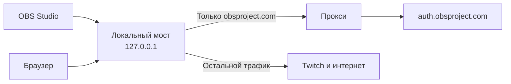

<p align="center">
  
</p>

<h1 align="center">Fix OBS Auth</h1>

<p align="center">
  <strong>Restore Twitch account linking in OBS Studio</strong>
  <br>
  Простой запуск · Автоматический поиск прокси · Минимум действий
</p>

<p align="center">
  
  
  
</p>

<p align="center">
  <a href="#-быстрый-старт">🚀 Быстрый старт</a>
  &nbsp;·&nbsp;
  <a href="#-команды">⌨️ Команды</a>
  &nbsp;·&nbsp;
  <a href="#-частые-проблемы">🛠️ Решение проблем</a>
</p>

---

## 📌 Содержание

- [Зачем это нужно](#-зачем-это-нужно)
- [Возможности](#-возможности)
- [Быстрый старт](#-быстрый-старт)
- [Что понадобится](#-что-понадобится)
- [Команды](#-команды)
- [Свои прокси](#-свои-прокси)
- [Структура проекта](#-структура-проекта)
- [Полезно знать](#-полезно-знать)
- [Частые проблемы](#-частые-проблемы)
- [Сообщество и поддержка](#-сообщество-и-поддержка)

## ❓ Зачем это нужно

Когда OBS Studio не может обратиться к `auth.obsproject.com`, привязка аккаунта Twitch может не работать.

**Fix OBS Auth** запускает OBS с локальным мостом, который направляет запросы к `obsproject.com` через прокси, а остальной трафик отправляет напрямую. Это позволяет использовать отдельную маршрутизацию для авторизации OBS без необходимости вводить логин и пароль от прокси в Twitch.

> [!NOTE]
> Схема ниже показывает предполагаемый маршрут запросов в рамках работы инструмента.



## ✨ Возможности

<table>
  <tr>
    <td align="center" width="33%">
      <h3>🔎 Автопоиск</h3>
      <p>Проверка доступных прокси и выбор рабочего варианта.</p>
    </td>
    <td align="center" width="33%">
      <h3>🎯 Выборочная маршрутизация</h3>
      <p>Отдельный маршрут для запросов к <code>obsproject.com</code>.</p>
    </td>
    <td align="center" width="33%">
      <h3>🔄 Восстановление</h3>
      <p>Команда для возврата настроек прокси Windows.</p>
    </td>
  </tr>
</table>

## 🚀 Быстрый старт

### 1. Запусти скрипт

Дважды нажми на `obs-auth.bat`.

### 2. Подготовь OBS

Если OBS уже открыт, скрипт спросит `Выключить OBS? (y/n)`. Ответь `y`, иначе OBS может не использовать подготовленную конфигурацию.

### 3. Привяжи аккаунт

После подготовки прокси OBS запустится автоматически. В OBS открой:

**Настройки → Трансляция → Twitch → «Привязать аккаунт»**

В открывшемся браузере войди в Twitch как обычно.

### 4. Заверши работу

Когда аккаунт подключится, вернись в окно скрипта и нажми **Enter**. Скрипт должен восстановить исходные настройки прокси Windows; OBS при этом закрывать не нужно.

> [!IMPORTANT]
> Не закрывай окно скрипта до завершения процедуры восстановления настроек.

## 💻 Что понадобится

| Компонент | Требование |
|---|---|
| Операционная система | Windows 10 или Windows 11 |
| Программа | OBS Studio |
| Список прокси | Необязательно: `proxies.txt` рядом с `obs-auth.bat` |
| Публичные прокси | Если собственного списка нет, скрипт использует источники, предусмотренные его настройками |

## ⌨️ Команды

Запускай команды из командной строки в папке проекта.

| Команда | Что делает | Когда использовать |
|---|---|---|
| `obs-auth.bat` | Обычный запуск | Для привязки аккаунта |
| `obs-auth.bat -Test` | Проверяет работу без запуска OBS | Перед основным запуском |
| `obs-auth.bat -NoLaunch` | Подготавливает прокси, но не открывает OBS | Для отдельной подготовки |
| `obs-auth.bat -Restore` | Восстанавливает настройки прокси Windows | Если настройки не вернулись автоматически |
| `obs-auth.bat -ListPath "C:\путь\к\списку.txt"` | Использует указанный файл прокси | Если список хранится в другом месте |

<details>
  <summary><strong>🧪 Пример проверки перед запуском</strong></summary>

  ```bat
  obs-auth.bat -Test
  ```

  Команда предназначена для проверки работы инструмента без запуска OBS.
</details>

## 🛒 Свои прокси

Создай файл `proxies.txt` рядом с `obs-auth.bat`. Каждая строка — отдельный прокси.

```text
ip:port:логин:пароль
```

Пример формата:

```text
203.0.113.10:8080:user:password
```

> [!WARNING]
> `203.0.113.10` — адрес из диапазона, зарезервированного для документации. Замени его на адрес своего прокси; пример не является рабочим сервером.

**Правила списка:**
- Прокси без логина и пароля тоже поддерживаются: `ip:port`.
- Строки, начинающиеся с `#`, игнорируются.
- Прокси проверяются по очереди; используется первый рабочий.
- Собственные прокси имеют приоритет над публичными.
- Чтобы обновить список, измени содержимое `proxies.txt`.

## 📂 Структура проекта

```text
fix-obs-auth/
├── obs-auth.bat        # Запуск инструмента
├── obs-auth.ps1        # Основной скрипт
└── proxies.txt         # Необязательный список прокси
```

## 🧠 Полезно знать

- Прокси используется для маршрута к `obsproject.com`; согласно описанию проекта, шифрование HTTPS не вскрывается.
- Если после сбоя скрипта сайты перестали открываться, попробуй выполнить `obs-auth.bat -Restore`.
- Привязка Twitch хранится в OBS. Если токен истечёт и аккаунт отключится, повтори процедуру.
- Лог локального моста: `%TEMP%\obs-auth-proxy\relay.log`.

## 🛠️ Частые проблемы

<details>
  <summary><strong>После завершения не открываются сайты</strong></summary>

  Запусти в папке проекта:

  ```bat
  obs-auth.bat -Restore
  ```
</details>

<details>
  <summary><strong>OBS был открыт до запуска скрипта</strong></summary>

  Если скрипт попросил закрыть OBS, подтверди закрытие (`y`), а затем повтори привязку аккаунта.
</details>

<details>
  <summary><strong>Не удаётся привязать Twitch</strong></summary>

  Проверь, что скрипт завершил подготовку прокси, браузер открыл страницу авторизации и в окне скрипта нет ошибок. При необходимости проверь лог:

  ```text
  %TEMP%\obs-auth-proxy\relay.log
  ```
</details>

## 🔗 Сообщество и поддержка

<p align="center">
  <a href="https://t.me/sjjewkk">
    
  </a>
  <a href="https://t.me/sentmebomb">
    
  </a>
  <a href="https://discord.com/users/sentbomb">
    
  </a>
</p>

<p align="center">
  Нашёл ошибку или есть предложение? Напиши автору проекта.
</p>

<p align="center">
  <a href="https://donatepay.ru/don/1540744">
    
  </a>
</p>

---

<p align="center">
  <sub>Fix OBS Auth · Инструкция и команды проекта</sub>
</p>
